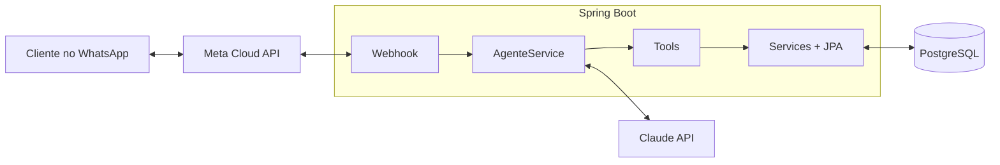

# Loja Bot — Atendente virtual com IA no WhatsApp

Atendente virtual para uma loja de moda fitness e moda praia. Ela responde clientes pelo WhatsApp, consulta o estoque por cor e tamanho, envia fotos das peças, faz reservas e passa a conversa para uma pessoa quando necessário.

> 🚧 **Em desenvolvimento.** Projeto de portfólio construído em fases; veja o [roadmap](#roadmap).

## Funcionalidades planejadas

**Para as clientes**
- Busca de peças em linguagem natural (“tem legging preta no M?”)
- Consulta de estoque por cor, estampa, tamanho e tecido
- Envio de fotos dos produtos
- Reserva de peças
- Transferência para atendimento humano

**Para a lojista**
- Cadastro de produtos pelo próprio WhatsApp (foto + legenda)
- Registro de vendas da loja física ao longo do dia
- Conferência de estoque no fechamento do dia

## Tecnologias

| Camada | Tecnologia |
|---|---|
| Backend | Java 21, Spring Boot 4 (Web, Data JPA, Validation) |
| Banco de dados | PostgreSQL + Flyway (migrations versionadas) |
| Inteligência artificial | Claude (API da Anthropic) com *tool use* |
| Mensagens | WhatsApp Cloud API (Meta) |
| Painel administrativo | Angular *(planejado)* |

## Arquitetura



O Claude nunca acessa o banco diretamente: ele decide qual *tool* usar, e o código da aplicação executa, valida e grava. Preço e estoque vêm sempre do banco, nunca da IA.

## Como rodar localmente

**Pré-requisitos:** Java 21 e PostgreSQL.

1. Crie o usuário e o banco no PostgreSQL (as tabelas são criadas pelo Flyway):
   ```sql
   CREATE USER atendente WITH PASSWORD 'sua_senha';
   CREATE DATABASE atendente OWNER atendente;
   ```
2. Copie `.env.example` para `.env` e preencha os valores, por exemplo:
   ```properties
   DATABASE_URL=jdbc:postgresql://localhost:5432/atendente
   DATABASE_USER=atendente
   DATABASE_PASSWORD=sua_senha
   ```
3. Suba a aplicação:
   ```bash
   ./mvnw spring-boot:run        # Linux/macOS
   .\mvnw.cmd spring-boot:run    # Windows (PowerShell)
   ```

A aplicação sobe em `http://localhost:8080`.

## Roadmap

- [x] **Fase 0** — Ambiente: Spring Boot, PostgreSQL e Flyway
- [ ] **Fase 1** — Catálogo: produtos, variações (cor/tamanho) e fotos
- [ ] **Fase 2** — Agente local com Claude e *tool use*, testado sem WhatsApp
- [ ] **Fase 3** — Integração com a WhatsApp Cloud API
- [ ] **Fase 4** — Fotos, reservas e transferência para atendente humano
- [ ] **Fase 5** — Cadastro de produtos e fechamento do dia pela lojista
- [ ] **Fase 6** — Painel administrativo em Angular
- [ ] **Fase 7** — Deploy e conta oficial do WhatsApp
- [ ] **Fase 8** — Containerização com Docker

## Autora

**Victoria Barros** — estudante de Análise e Desenvolvimento de Sistemas no IFS.
[GitHub](https://github.com/vic-barros)
